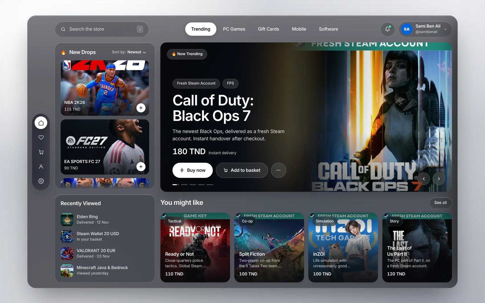

# TechGarage — website demo

A design demo for [techgarage.tn](https://techgarage.tn/), built to the layout of the
supplied reference mockup: a frosted-glass storefront floating over a slow grey/white
gradient. Digital goods only — PC games, gift cards, mobile top-ups and software.



## Running

Static files, no build step and no dependencies:

```bash
cd techgarage-demo && python3 -m http.server 8000
```

Then open <http://localhost:8000>. It must be served over HTTP rather than opened as a
`file://` path, because the scripts are ES modules.

## What's real

Every product name, price and category comes from the live techgarage.tn catalogue —
24 digital products: game keys and fresh Steam accounts, Steam / PlayStation / iTunes /
Riot gift cards, eFootball and PUBG Mobile top-ups, a Windows licence and Discord Nitro.
Hardware is deliberately left out. Prices are whole dinars, shown as `180 TND`. The contact
details and the brand accent (`#38a699`, sampled from the site's CSS) are theirs too.

The shopper, the notifications and the "recently viewed" history are invented, as a demo
needs an account to show.

## Layout

| Region | Contents |
| --- | --- |
| Icon rail | Store, wishlist, basket, account, support — with live badges |
| Top bar | Search, category tabs (Trending, PC Games, Gift Cards, Mobile, Software), notifications, account chip |
| Left column | New Drops (sortable, scrolls) and Recently Viewed |
| Hero | Five-slide carousel: autoplay, arrows, swipe, arrow keys |
| Shelf | Four recommendations, filtered by the active tab |

## Interactions

Carousel autoplay with per-slide progress, pausing on hover; pointer parallax on the
hero art. Category tabs with a sliding pill. Live search with match highlighting,
arrow-key navigation and `/` to focus. Sortable New Drops. Quick-view sheet with specs.
A basket drawer with quantity steppers and a running TND total, an add-to-basket
animation that arcs the product into the rail, toasts, and a wishlist. Basket and
wishlist persist in `localStorage`.

Keyboard: `/` focuses search, `←` `→` drive the carousel, `Esc` closes any overlay.
`prefers-reduced-motion` disables the drifting background, the autoplay and the
transitions.

## Design notes

Apple's own typeface: the font stack asks for the system font, so every Mac, iPhone and
iPad renders SF Pro (Apple's licence doesn't allow hosting SF Pro on a non-Apple site).
Other devices get Inter, the closest open design, with optical sizing. Type follows
Apple's habits — 15px body at 1.47 line height, tracking that tightens as size grows,
tabular figures for prices. Every text style clears WCAG AA contrast (4.5:1) against the
glass. The background is a set of
slowly drifting radial light pools over a grey gradient, with an SVG grain overlay so it
never reads as flat vector mush; everything animated moves on `transform` only.

The store's artwork is square but the hero is roughly 3:1, so cover-cropping it would
throw the poster away — instead a blurred copy builds the backdrop and the sharp artwork
sits on top, its left edge feathered into the stage with a mask. Search ranks hits on the
displayed name above the long store title, so "steam" finds the Steam Wallet cards before
every Fresh Steam Account.

## Images

`assets/products/` holds 24 images sourced from techgarage.tn, with the white matte
some of them ship with trimmed off, capped at 820px and converted to WebP.

`assets/avatars/` holds five avatars generated by `scripts/build_avatars.py`, which uses
[gravify](https://pypi.org/project/gravify/) to resolve Gravatar URLs for demo
identities and bakes the results in, so the page makes no third-party requests at
runtime. To regenerate:

```bash
pip install -r scripts/requirements.txt
python3 scripts/build_avatars.py
```

## Files

```
index.html              markup
assets/css/app.css      all styling
assets/js/data.js       the catalogue
assets/js/app.js        behaviour, no dependencies
assets/products/        product imagery
assets/avatars/         gravify-generated avatars
scripts/                avatar generation
```
